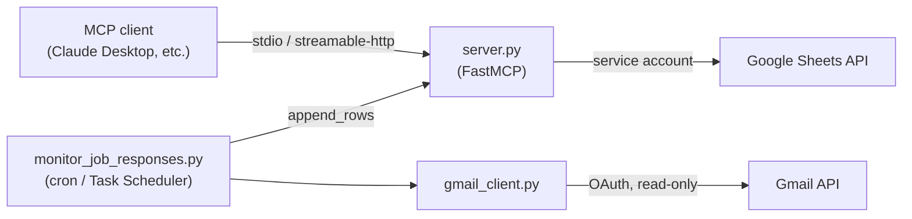

# Google Sheets MCP Server

[](https://github.com/JasonEckardt/google-sheets-mcp-server/actions/workflows/ci.yml)

[](LICENSE)

An [MCP](https://modelcontextprotocol.io) server that wraps the Google
Sheets API -- list tabs, read ranges, append rows, overwrite ranges, and
add dropdown (data validation) rules -- plus an optional scheduled script
that scans Gmail for new messages matching a pattern and appends rows for
the ones that match, skipping ones that look like rejections/negatives.

Originally built to maintain a job-application tracker (new interview/offer
emails in, auto-filtered rejections out), but the server itself is generic:
any project that needs programmatic Sheets read/write/dropdown access from
an MCP client can use it as-is.

## Features

- `list_sheet_tabs` -- list tabs, their IDs, row/column counts
- `read_range` -- read cell values from an A1-notation range
- `append_rows` -- append rows after existing data
- `update_range` -- overwrite an exact range
- `set_dropdown_validation` -- add a dropdown (data validation list) to a column
- `monitor_job_responses.py` -- optional incremental Gmail-to-Sheet monitor, safe to run on a schedule (dedupes via a local state file, skips rejections via keyword matching)

## Architecture



Two independent credential paths: the Sheets side uses a **service account**
(sheets explicitly shared with it), while the Gmail side uses a personal
**OAuth "Desktop app"** flow -- personal Gmail accounts can't delegate to a
service account, so the monitor authenticates separately with a read-only
scope.

## Prerequisites

- Python 3.10+
- A Google Cloud project with the **Google Sheets API** enabled
- A **service account** with a downloaded JSON key
- The target spreadsheet shared with that service account's `client_email` as **Editor**

## Installation

```
git clone https://github.com/JasonEckardt/google-sheets-mcp-server.git
cd google-sheets-mcp-server
pip install -e .
cp .env.example .env
```

For development (tests + lint):

```
pip install -e ".[dev]"
```

Edit `.env`:

```
GOOGLE_SERVICE_ACCOUNT_FILE=service_account.json
DEFAULT_SPREADSHEET_ID=your_spreadsheet_id_here
```

Place your service account key in this folder (matching the filename in
`.env`). **Never commit this file** -- it's already gitignored.

## Running the MCP server

### Local / stdio (Claude Desktop, or any local MCP client)

```
python server.py
```

Claude Desktop config example (`claude_desktop_config.json`):

```json
{
  "mcpServers": {
    "google-sheets": {
      "command": "python",
      "args": ["/absolute/path/to/server.py"]
    }
  }
}
```

### Remote / Streamable HTTP

```
MCP_TRANSPORT=streamable-http python server.py
```

Some MCP clients (e.g. Claude's web/Cowork custom connectors) only accept
remotely-hosted servers reachable over HTTPS, authenticated via OAuth 2.0 --
not a local stdio process and not a bare API key/bearer token. If you need
that, you'll additionally need to:

1. Host this server somewhere with a public HTTPS URL (Cloud Run, Fly.io,
   a small VPS, etc.).
2. Put an OAuth 2.0 authorization server in front of it (the `mcp` Python
   SDK has built-in support for this via `FastMCP(auth_server_provider=...)`,
   which handles `/authorize`, `/token`, and token verification for you --
   you mainly need to implement client/token storage).

That's genuine infrastructure work, not a config toggle -- budget for it
accordingly if your use case needs a hosted connector rather than local stdio.

## Example: seeding a tracker sheet

[`examples/seed_tracker.py`](examples/seed_tracker.py) shows how to drive the
server's tool functions directly from a plain Python script (no MCP client
needed): it appends a few rows to a `Tracker` tab and adds a Status dropdown
to column E. The data in it is fictional -- use it as a template.

## Optional: scheduled Gmail monitor

`monitor_job_responses.py` searches Gmail for messages matching a keyword
query, skips anything that looks like a rejection or that's already been
processed, and appends the rest to the sheet with `Status = "Needs Review"`
for you to confirm/correct.

Because personal Gmail accounts can't grant a service account access
(domain-wide delegation only works on Google Workspace), it uses its own
OAuth "Desktop app" credentials:

1. Enable the **Gmail API** in the same (or a different) Google Cloud project.
2. Create an OAuth client ID of type **Desktop app**, download it, save as
   `gmail_client_secret.json` in this folder.
3. Run `python monitor_job_responses.py` once, interactively -- it opens a
   browser for one-time consent, then caches a refresh token in
   `gmail_token.json` so future scheduled runs don't need a browser.

Then schedule it with cron or Task Scheduler, e.g.:

```
0 8 * * * cd /path/to/repo && python3 monitor_job_responses.py >> monitor.log 2>&1
```

**Limitation:** classification is keyword-based, not a language model -- it
can catch obvious rejection phrasing but won't reliably distinguish subtler
cases. Treat `Needs Review` rows as a draft, not ground truth.

## Development

```
ruff check .   # lint
pytest         # unit tests (pure functions only -- no Google credentials needed)
```

CI runs both on every push/PR via GitHub Actions; a `Jenkinsfile` is also
included for running the same pipeline on a Jenkins instance.

## Roadmap

- **OAuth 2.0 authorization layer** for the streamable-http transport, so the
  server can be hosted publicly and registered as a remote MCP connector
  (the `mcp` SDK's `auth_server_provider` hook does most of the heavy lifting).
- **Smarter response classification** -- replace the keyword/regex rejection
  filter with an LLM pass so subtle "no news yet" vs. "interview scheduled"
  cases are handled correctly.
- **Sheet-based dedupe state** for the monitor, so scheduled runs don't
  depend on a local JSON state file.

## Security

- `service_account.json`, `gmail_client_secret.json`, `gmail_token.json`,
  and `.env` are gitignored -- keep it that way, they're all credentials.
- The service account can only touch sheets/files explicitly shared with it.
- The Gmail OAuth token is scoped read-only (`gmail.readonly`).
- Rotate/revoke credentials in Google Cloud Console if ever exposed.

## License

MIT -- see [LICENSE](LICENSE).
